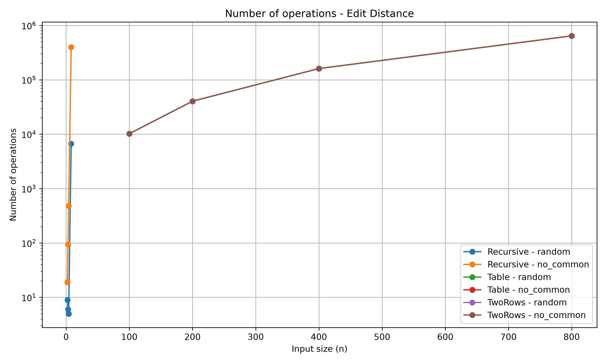
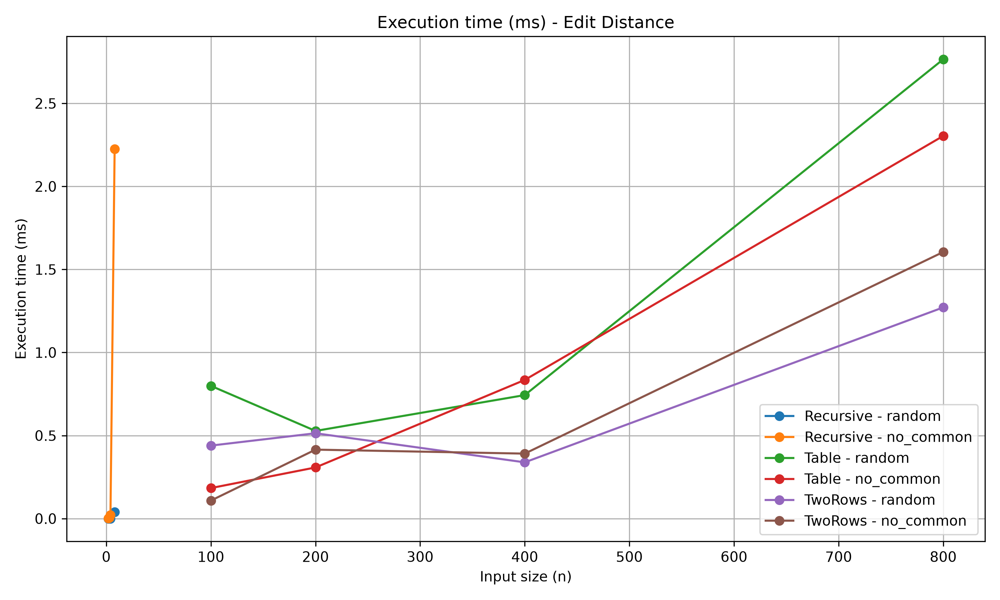
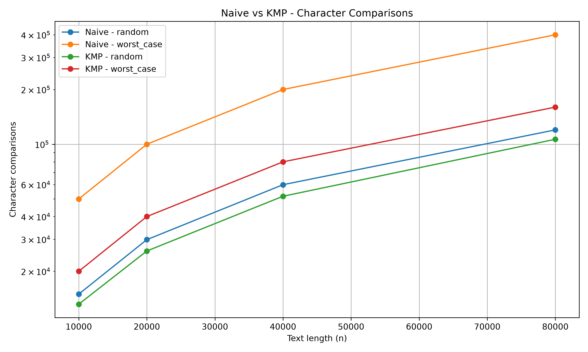

# Assignment 4 — Dynamic Programming and String Algorithms

## 1. Experiment Design Card
### Research Question
How do different implementations of Edit Distance and String Search algorithms compare in execution time, number of operations, and memory usage?

### Input Sizes
| Algorithm | Input Sizes |
|---|---|
| Recursive Edit Distance | 2, 3, 4, 8 |
| Table Edit Distance | 100, 200, 400, 800 |
| Two Rows Edit Distance | 100, 200, 400, 800 |
| Naive String Search | 10,000, 20,000, 40,000, 80,000 |
| KMP String Search | 10,000, 20,000, 40,000, 80,000 |

### Input Types
- Random strings generated using a fixed seed (42).
- No common characters for Edit Distance.
- Worst-case string search using repeated A characters and pattern AAAAB.

### Metrics
- Execution time in milliseconds.
- Recursive calls for Recursive Edit Distance.
- Computed cells for Table and Two Rows.
- Character comparisons for Naive and KMP.
- Theoretical auxiliary memory complexity.

### Prediction
- Recursive Edit Distance will have exponential time complexity.
- Table Edit Distance will use O(n*m) time and O(n*m) memory.
- Two Rows Edit Distance will use O(n*m) time and O(min(n,m)) memory.
- Naive Search may perform many repeated comparisons.
- KMP will provide linear search complexity.

## 2. Algorithms

### Edit Distance
Three implementations were developed:
1. Recursive: solves the problem using recursion without memoization.
2. Table: uses a two-dimensional dynamic programming table.
3. Two Rows: optimizes memory by storing only two rows.
All implementations support insertion, deletion, and replacement operations.

### String Search
Two algorithms were implemented:
1. Naive String Search: checks every possible starting position.
2. KMP: uses the LPS array to avoid unnecessary comparisons.
Both algorithms support overlapping matches.

## 3. Experimental Results
The experiments were performed using Java 21.
The execution time was measured using System.nanoTime().
One warm-up run and five measured runs were used. The median execution time was recorded.
The results are stored in results/results.csv.

## 4. Plots

### Edit Distance Operations

This graph compares the number of operations performed by the three Edit Distance implementations.

### Edit Distance Execution Time

This graph compares the execution time of the three implementations.

### String Search Comparisons

This graph compares Naive and KMP character comparisons for random and worst-case inputs.

## 5. Analysis
Recursive Edit Distance performs repeated calculations, which causes exponential growth in execution time.
Table Edit Distance stores all computed values, requiring O(n*m) memory.
Two Rows uses the same dynamic programming recurrence but stores only two rows, reducing auxiliary memory to O(min(n,m)).
Naive String Search can repeat comparisons when partial matches occur.
KMP uses the LPS array to skip unnecessary comparisons and achieves O(n+m) time complexity, including preprocessing.

## 6. Conclusion
The experiments demonstrate the importance of algorithm optimization.
Dynamic programming significantly reduces repeated calculations compared with basic recursion.
The Two Rows implementation improves memory efficiency while preserving the same time complexity as the full DP table.
KMP is more efficient than Naive Search on inputs with repeated prefixes and suffixes.

## 7. Reproducibility
- Programming language: Java 21
- Build tool: Maven
- Testing framework: JUnit 5
- Random seed: 42
- Warm-up runs: 1
- Measured runs: 5

Run tests:
mvn clean test
Run benchmarks:
Run benchmark.BenchmarkMain from IntelliJ IDEA.
Generate plots:
py plot_results.py
